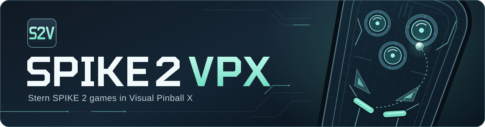
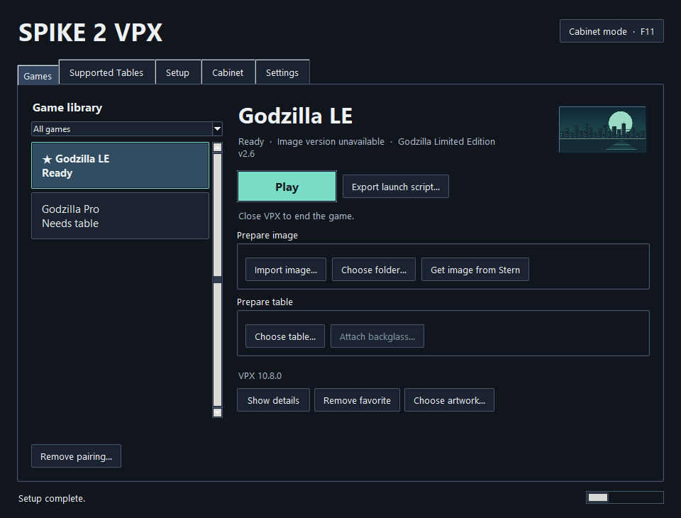
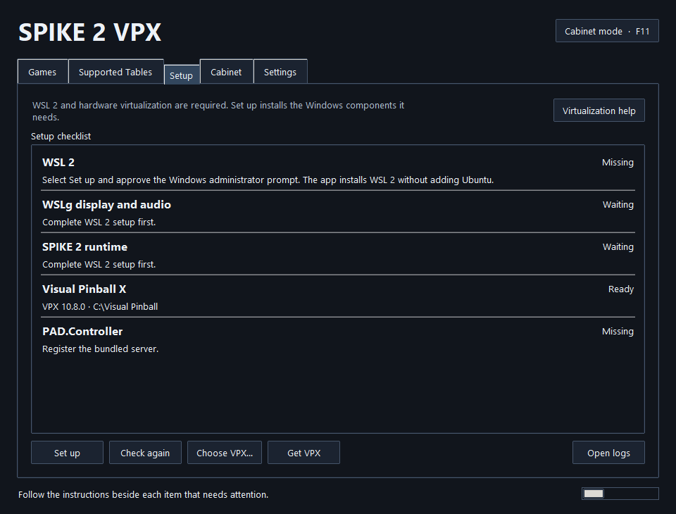
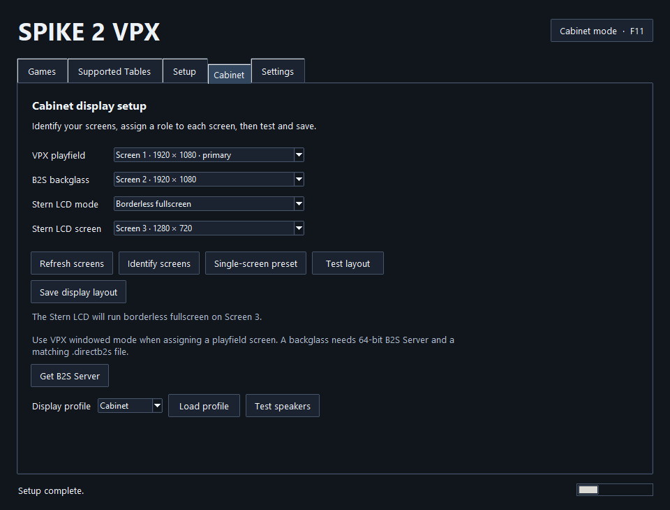

# 

Play Stern SPIKE 2 games with Visual Pinball X on Windows x64. VPX runs the
playfield and the SPIKE 2 runtime runs the game, LCD, and audio. The bundled
`PAD.Controller` connects them.

## Credits

This project is based on the work of **David Vanderburgh**. All credit to
David Vanderburgh for making this possible. Visit his repository for the full
functionality. [Pinball Asset Decryptor](https://github.com/davidvanderburgh/pinball-asset-decryptor)

No Stern or game code is shipped in this repo.

## Screenshots



<details>
<summary>Show setup and cabinet screenshots</summary>





</details>

## Set up

Open **SPIKE 2 VPX** from the Start menu, or run `python Spike2Vpx.pyw` from a
checkout with x64 Python and Tcl/Tk. For a checkout, install the bundled
Python dependencies with `python -m pip install -r requirements-windows.txt`.

**WSL 2 (Windows Subsystem for Linux) and hardware virtualization are required.**
In the app, select **Set up** and approve the Windows administrator prompt.
Setup enables Virtual Machine Platform, installs or updates WSL as needed, and
imports the app's private `SPIKE2-VPX` distribution. If Windows requests a
restart, restart and reopen the app to continue setup.

If setup reports a virtualization problem, open **Task Manager → Performance →
CPU** and check **Virtualization**. If disabled, consult your PC manufacturer's
instructions for entering BIOS/UEFI. Enable **Intel Virtualization Technology
(VT-x)** or **AMD-V / SVM Mode**, save the firmware settings, and boot back into
Windows. Reopen the app and select **Set up**. A Windows virtual machine needs
nested virtualization enabled on its host.
[Microsoft's guide to enabling virtualization](https://support.microsoft.com/en-us/windows/experience/enable-virtualization-on-windows)

The checklist also covers WSLg display and audio, Visual Pinball X 10.8+ x64,
and the controller. **Get VPX** opens the VPX download page. After installing
VPX, use **Choose VPX** if the app needs help locating `VPinballX64.exe`.
Settings and setup logs are under `%LOCALAPPDATA%\Spike2Vpx`.

Setup verifies that WSL can execute an ARM program inside a chroot. It
repairs a missing ARM handler in the app's distro, and the launcher checks
again before preparing a game in case WSL has restarted. This repair keeps
your existing distribution, card images, and cache.

## Prepare and play

Supply your own SPIKE 2 SD-card image and a compatible VPX table. Godzilla LE
is the reference title. The VPX kit can create a patched copy of a recognized
table. Keep the patched table and `PADSPIKE2.vbs` together.

```powershell
python tools/spike2_emu/vpx/padvpx.py patch "C:\Tables\Godzilla limited edition.vpx"
.\Play-Spike2Vpx.ps1 -Card "C:\Images\godzilla_le.sdcard.raw" -Table "C:\Tables\Godzilla limited edition (PAD).vpx"
```

Browse **Supported Tables** to find the table version for your game and open
its download page where one is listed. In **Games**, **Get image from Stern**
opens Stern's download page. Use **Import image** with a local `.raw` or a ZIP
containing one `.raw`, or select a folder of raw images. The app reads the
title and edition from the image and checks space for the optional cache.
Choose a compatible VPX table to make a playable `(PAD).vpx` copy, or use an
existing prepared table. The app saves new conversions and their companion
files beside the original table. Prepared pairings appear in the game library.
Select **Play** to start the game and
open VPX. Closing VPX stops the run and returns to the library.

VPX opens directly in play mode with the editor hidden. With the bundled
controller, the table starts loading as soon as the launcher finds its Stern
session, while the emulator is still starting.

The runtime builds the guest filesystem from a card on its first run and
opens the source image read-only. Stern high scores and machine settings are
saved per title in the app's WSL runtime and reused on later launches. The
first launch after upgrading imports any existing save data it finds for
that title in the runtime's rig slots. The PowerShell launcher also accepts
`-VpxExe` and `-Distro` overrides. Manage game volume and card caching in
**Settings**.

## Cabinet displays and front ends

Open **Cabinet** and select **Identify screens**. Assign the VPX playfield,
B2S backglass, and Stern LCD to separate screens, or start with the
**Single-screen preset**. Select **Test layout** to preview the assignments
before saving. Use VPX windowed mode for app-managed playfield placement.
Under **Stern LCD mode**, choose **Borderless fullscreen** or **Windowed**,
then select **Save display layout**. Borderless fullscreen uses the screen
selected under **Stern LCD screen**. The **Automatic (spare screen)** default
uses a spare secondary screen when available and opens a window otherwise.
Windows places the fullscreen LCD using the same display coordinates as
**Identify screens**.
When the cabinet and Windows display numbers differ, Cabinet shows both.
The renderer starts at the selected screen's size for fullscreen play.
The single-screen preset uses VPX and B2S defaults and a windowed Stern LCD.

A managed backglass needs 64-bit B2S Server and a matching `.directb2s`
file. The app carries over a matching file when it patches a table. Use
**Attach backglass** if you downloaded it separately. A custom table
`.res` file takes precedence over the app's backglass placement.
Choose **Disabled** under **B2S backglass** and save the layout to play
without B2S. Select a screen or **B2S default** to turn it back on.

In **Games**, select a prepared game and choose **Export launch script**.
For LaunchBox, use the exported `.bat` as the game's **Application Path**
and leave emulator selection off. The script uses the current SPIKE 2 VPX
settings and stays running until VPX closes. Export again after moving
the app, table, or image to a different path.

## Library and maintenance

In **Games**, use the library cards to see which editions are ready and which
need an image, table, or setup. The detail view shows the matched VPX release
and an SD image version when its filename has one. **Show details** reveals
paths and logs. Add favorites and optional local PNG or GIF artwork, and use
**Recently played** to find games you launched.

The app includes small PNG previews in `assets/backglasses/`. Add a PNG
named for a title's detected ID, such as `godzilla_le.png`, to bundle a
preview for that title. Use artwork you can redistribute. The app previews the
main image in the matching local `.directb2s` beside a prepared table. A
player's custom artwork takes priority. If the backglass has no usable
image, the app uses the bundled title preview or `default.png`.

Press **F11** for the fullscreen cabinet library. Use Up/Down or cabinet
flippers mapped to the left/right Shift keys, Enter or Space to select, and
Esc to leave. In **Cabinet**, choose **Desktop** or **Cabinet** and save your
screen assignments to that profile. **Load profile** applies a saved layout.
**Test layout** outlines the assigned screens. **Test speakers** plays a tone
using the current volume and the Windows default output.

If playback fails, the launch screen shows the last stage reached and a next
action. **Recover session** appears after the app verifies a stale record with
an expired heartbeat and no live processes in its slot. Active or unverifiable
sessions must be closed before retrying.

In **Settings**, **Preview support report** shows the exact text you can save
as a diagnostic ZIP. **Back up library** stores your pairings, artwork paths,
favorites, play history, display profiles, and preferences as JSON. Copy your
image, table, and artwork files separately when moving to another PC. After
restoring, use **Locate image** or **Locate table** for files that moved and
verify the display assignments on the new PC.

## Build and test

Run `.\scripts\build-windows-installer.ps1` with full x64 Python with Tcl/Tk
and Inno Setup 6.3 or later. The build writes
`installer\Output\SPIKE2-VPX-Setup.exe`. The installer bundles the tools and
Python. The first setup downloads the upstream runtime image and verifies
its pinned SHA-256. Uninstall preserves the private runtime and player data.

```powershell
python -m pip install -r requirements-dev.txt
python -m pytest -q
```
